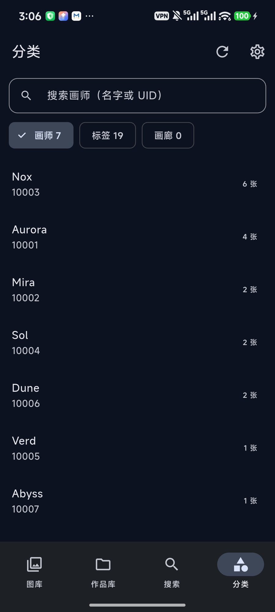

# 光锥图库 · LightCone Gallery（Android / Flutter）

> 本地优先的 Pixiv 作品仓库：索引 pixez 下载到的图，按作品归组、竖排长图看画，
> 收藏 / 评分 / 标签画廊全部离线可用。与桌面端
> [lightcone-gallery](https://github.com/AuroraEvelynAria/lightcone-gallery)
> 共用同一套 schema v12，元数据、收藏与评分可以在两端之间合并。

<p align="center">
  
  
  
  
  
</p>

> 截图里的插画是脚本生成的占位图（`tool/make_demo_art.py`），不包含任何真实作品。

## 功能

- **一个作品一张卡**：同一 PID 的几十页只占一格，右下角标页数
- **竖排长图**：详情页把所有页按原比例竖向拼接，点任意一页进单张检视器（左右滑）；
  横图不会被压成顶栏下的一条 —— 给更高的舞台与模糊环境底，第一页还会让开顶栏
- **沉浸式详情**：图片顶到状态栏，顶栏只有浮动的返回 / 分享 / 菜单（pixez 同款，
  不压标题与整条黑罩），标题与画师在图片下方；底部常驻收藏 / 在 Pixiv 打开
- **收藏 · 评分 · 标签画廊 · 多选批量操作**
- **分享 · 设为壁纸**：详情页可把整组图一次分享（多页走 `ACTION_SEND_MULTIPLE`），
  检视器分享当前一张；分享走 `FileProvider`，不暴露真实路径。聊天软件默认会压缩
  图片，所以另给了「以文件分享（不压缩）」和「保存原图到相册（Pictures/LightCone）」。
  菜单里可设为主屏 / 锁屏 / 同时。
- **目录可选**：首次启动选图库目录（默认 `Pictures/pixez`），设置里随时更换
- **与桌面互通**：导入桌面备份（元数据 / 收藏 / 评分 / 画廊），也能导出 `.db` 回桌面
- **观感**：六套配色、深浅主题、R-18 封面模糊、自适应布局（横屏左侧导航）
- **元数据补全**：免 OAuth 的 Pixiv ajax 端点，限流语义与桌面版一致

## 为什么换 Flutter，以及它为什么流畅

> 这是手机端的第三个实现：Tauri/WebView → Kotlin/Compose → **Flutter**。
> 换栈的原因不是框架崇拜，而是**流畅度**：参照片源客户端 pixez 的做法，
> 把「网格里显示什么」和「构建产物」这两件事做对。

| | pixez | Kotlin 版（之前） | 本版 |
|---|---|---|---|
| 网格里的图 | CDN 的 360~540px 缩略图 | **本地 2000~3000px 原图现解** | **系统缩略图**（MediaProvider 预生成） |
| 构建 | release | debug（无优化） | release |
| 每格解码成本 | 极小（图本身就小） | 大（8~12MP JPEG） | 极小（`loadThumbnail`，命中系统缓存） |

所以本版的关键设计只有一条：**网格里永远不解码原图**，缩略图走
`ContentResolver.loadThumbnail`（Android 29+，更低版本走旧 Thumbnails API）。
原图只在检视器里解一次。

## 结构

```
lib/
  main.dart                    启动壳：第一帧出开屏，开库/迁移在背后跑
  state/
    app_state.dart             权限 / 扫描 / 导入 / 数据版本（刷新信号）
    app_settings.dart          本机偏好：主题、网格列数（settings 表，mobile_ 前缀）
  data/
    schema.dart                与桌面 schema v12 **逐字对齐**的建表语句
    db.dart                    sqflite 打开 / 校验 / 导入桌面备份（版本+quick_check）
    models.dart                模型 + parsePid / parseArtist（与 Rust 测试镜像）
    repository.dart            所有 SQL：分页 / 检索 / 分类 / 扫描增量 / 元数据落库
  media/
    media_channel.dart         原生通道（枚举 / 缩略图 / 权限 / 选备份）
    thumbnail_provider.dart    系统缩略图 ImageProvider
  pixiv/pixiv_client.dart      免 OAuth ajax 端点 + 代理 + 桌面同款限流语义
  ui/
    splash_screen.dart         开屏（光锥标记 + 淡入）
    settings_screen.dart       设置：外观 / 数据 / 网络 / 关于
    artwork_detail_screen.dart 作品详情（pixez 层级：大图翻页 / 标题 / 画师 / 标签 / 收藏）
    page_stage.dart            长图一页的版面（横页舞台 / 模糊底 / 顶栏让位，可单测）
    filtered_artworks_screen.dart 画师 / 标签筛选后的瀑布流
    brand.dart                 光锥标记的 CustomPainter（开屏与关于共用）
    ...                        四 tab + 检视器 + 补全面板
android/app/src/main/kotlin/.../MediaStoreChannel.kt
                               枚举 / loadThumbnail / 权限 / SAF 选备份
android/app/src/main/res/drawable/ic_lightcone*.xml
                               系统开屏图标与自适应图标（矢量，同一标记）
```

## 与桌面端的数据互通

- 打开的是**同一套 schema v12**（16 张表）；`sqflite` 就是 Android 原生
  SQLite，不做 Room 那种逐列校验，所以导入桌面备份**直接换文件**即可：
  校验 `user_version == 12`、`quick_check == ok`、必需表齐全 → 关库 →
  拷贝 → 删 `-wal/-shm` → 重开。
- 本端额外多一张私有表 `media_ids(path, media_id)`（每次打开 `IF NOT EXISTS`
  补建）：缩略图要拿 MediaStore 行号去要，路径是唯一的稳定桥梁。
  桌面导入的行没有行号，UI 自动退回文件解码。

## 扫描语义（与桌面 / Kotlin 版一致）

- 作品库：MediaStore 一次枚举 → **只认 `Pictures/pixez` 根下的文件**（与图库同口径，
  别处下载的 pixiv 命名文件不再混进来）→ `{pid}_p{n}` 解析 → `(pid,page)` 去重 +
  忽略名单 + 画师路径反推 + 根目录落盘。已知 `(pid,page)` 换了路径（桌面导入后
  重扫）会就地更新为手机路径，不会因为唯一索引而卡住旧路径。
- 图库：**扫当前根目录**（默认 `/storage/emulated/0/Pictures/pixez`，首次启动引导里
  可以选别的目录，之后在设置里也能换），按 `(path,size,mtime)` 增量 + 差集删除。
  旧版把整个 `Pictures` 当根的库会在启动时自动迁移并清掉不在根下的行。
  换根会就地迁移旧库（收藏/评分保留在新根下的文件上），不在新根下的索引立刻清掉。
- 分类：画师 / 标签**不设上限**（早期写死 500，真机验证时发现并去掉），
  顶部搜索框在内存里按名字过滤，标签几千个也能秒找（标签列表按作品数排序）。
- 元数据补全：串行 800ms、连续 3 败中止、429/403 立停、每 200 条歇 30s、
  非 200 不重试、限流词跨语种判定。代理与桌面共用 settings 表的
  `pixiv_proxy` 键（导入备份自动带来）；**127.0.0.1/localhost 在手机上会被
  视为「直连」**（桌面的回环地址在手机上指向手机自己）。
- **从另一份 LightCone 索引合并元数据**（⋮ →「从桌面备份补元数据」）：
  `ATTACH` 源库后只 `INSERT OR REPLACE` `illust_meta`（成功/确认删除的行）、
  `illust_tags` 与 `artists.name`，**不动本机 artworks / images**。
  桌面已有 4,183 条元数据 + 31,075 个标签时，这一步几乎瞬间完成，
  剩下的新作品再联网补 —— 不必对着 6,700 条串行抓 90 分钟。
  原因：桌面库的 `original_path` 是 Windows 路径，整库替换会让手机上的图全打不开；
  而元数据按 PID 挂，与路径无关。

## 以 pixez 为标准的界面

- **自适应布局**：宽度 ≥ 600dp（横屏 / 平板）时底部导航换成左侧 `NavigationRail`，
  四个 tab 不变；竖屏仍是底部 `NavigationBar`。
- **多选批量操作**（作品库）：长按任意卡片进入多选，点卡片勾选/取消；底部动作
  条是「已选 N · 收藏 · 移出」。收藏按 PID 整组写，移出只动索引。
- **标签画廊**（分类页第三个 chip）：只读桌面端的 `tag_galleries`（名字 + 标签
  组合），点进去用这些标签筛作品；元数据合并时会一并带过来。
- **导出备份**：设置 →「导出备份」把当前索引写成一个 `.db`（WAL checkpoint 后
  拷副本），经 SAF 让用户选保存位置；桌面端「导入备份」可直接用。不用
  `VACUUM INTO` —— Android 8 的 SQLite 没这条语法。
- **网格**：圆角卡片（8dp）+ 6dp 间距；缩略图请求尺寸按「每格实际像素」算
  （2 列 → 540px，5 列 → 216px），换列数不会糊。
- **沉浸式顶栏**（对齐 pixez）：`extendBodyBehindAppBar` + 透明 AppBar + 顶部渐变
  压暗，图片从状态栏底下开始，返回 / 菜单 / 标题（17sp）+ 画师（11sp）浮在图上；
  信息块在图片下方，操作放底部常驻栏。
- **详情页 = 竖排长图**（pixez 的「看的时候拼成长图」）：**图片顶在最上面**，
  标题 / 画师固定收在 AppBar 副标题；完整信息（标题 / 画师 / 评分 / PID / 页数 /
  日期 / 标签）在长图之后。所有页按原始比例竖向拼接，页与页之间 2px 缝；
  **点任意一页**进单张检视器，左右滑切页。用 `SliverList` 按需构建，51 页也
  不会一次性解码；解码按屏宽 `cacheWidth`，不会整张原图进内存。
- **横页单独排版**（`ui/page_stage.dart`）：宽高比 > 1.2 的页给一个至少
  `0.56 × 屏宽` 高的舞台，空出来的地方铺同一张图的模糊放大（1/8 尺寸解码再
  高斯模糊，成本可忽略）；**作品第一页是横图时，舞台顶部让出状态栏 + 顶栏的
  高度**，真图从顶栏下方开始 —— 旧版 3.5:1 的全景图只剩顶栏底下一条，既难看
  又点不到。左下角「看全图」只是提示，整块舞台都可点进检视器。
- **检视器双击缩放**：横图默认整张显示（铺满宽度），双击在「整张」和
  「铺满屏高」之间切换（3.5:1 约 7.7 倍），放大后左右拖动看细节；横图底部有
  「双击切换大小 · 拖动查看」提示。竖图双击给 2 倍，比例未知也按 2 倍。
- **一个作品一张卡**：图库 / 作品库 / 搜索 / 筛选页都按 PID 归组（封面 = 最小页，
  多页作品右下角有「N」页角标）。之前的实现把 51 页拆成 51 张卡，真机上就是
  同一个角色刷满整屏。
- **详情页底部常驻**「收藏 / 在 Pixiv 打开」：51 页的长图滚到底要两万多像素，
  动作不能埋在信息末尾。
- **日期分两个**：`上传` 取 Pixiv 的 `illust_meta.create_date`（作品发布日），
  `保存` 取本地文件 `images.modified_at` 的最大值（下载到手机的时间）。两者分开
  显示，元数据还没补的作品就只显示保存时间。
- **收藏 / 评分**：作品库顶部有「收藏」筛选；详情页顶栏只有浮动图标，
  标题 / 画师 / 评分在图片下方的信息区，评分是 5 星、再点同一颗清零。两者都按
  PID 整组生效（`images` 里同一 PID 的所有页一起改）。
- **从桌面备份补元数据**时，除了标题/画师/标签，还会按 PID 合并**收藏与评分**
  （桌面的路径是 Windows 的，不能按 path 对；手机端取组内最大值）。
- **R-18 封面模糊**（设置 → 外观，默认开，键 `mobile_blur_r18`）：网格里
  `x_restrict > 0` 的封面用 GPU 高斯模糊 + `R-18` 角标，**点进详情正常显示**。
  判定用 Pixiv 的 `x_restrict` 而不是看标签 —— 本库 4,183 个作品里只有 655 个
  是 Pixiv 标记的 R-18（另外 13 个带 R-18 标签但 x_restrict=0），所以看着露骨的
  图不一定被糊，这是按 Pixiv 的尺度走的结果。
- 详情页右上角菜单里有「移出作品库」（两段确认、不动原图）；作品库瀑布流里
  长按也能移除单页。
- 曾经用 `precacheImage` 预热 PageView 的左右邻页；改成竖排长图后这套就不需要了
  （`ListView` 的 `cacheExtent` 会顺带构建下一屏），已移除。

## 设置与开屏

- **首次启动引导**（`ui/onboarding_screen.dart`）：数据库里还没有任何图库时显示，
  让用户选目录（默认 `Pictures/pixez`，或 SAF 选任意内部存储目录）。SAF 的 tree
  URI 由原生侧 `DocumentsContract.getTreeDocumentId` 解析成绝对路径前缀；只支持
  主存储（`/storage/emulated/0/...`）。
- **开屏**：`main()` 只做 `runApp`，开库 / `ensurePhoneLibrary` / 读设置都在开屏
  背后跑，最短停留 600ms 以免一闪而过；权限对话框放到主界面出现之后，不盖在
  开屏上。Android 12+ 的系统启动窗口也是同一品牌色（`values-v31` +
  `values-night-v31`），从系统开屏到 Flutter 第一帧不会闪白。
- **图标**：`drawable/ic_lightcone.xml`（系统开屏）与
  `drawable/ic_lightcone_foreground.xml` + `mipmap-anydpi-v26`（自适应图标）都是
  同一个矢量光锥，不再用 Flutter 默认图标。
- **设置页**（首页右上角齿轮）：
  - 外观：主题（跟随系统 / 深色 / 浅色）、**配色**（深空蓝 / 樱粉 / 海盐青 /
    森绿 / 琥珀 / 紫罗兰，种子色 + 对应深色底）、网格列数（自动 / 2 / 3 / 4 / 5）、
    **模糊 R-18 封面**（默认开）；
  - 数据：图片/作品/页/画师/标签/元数据/收藏计数、**图库目录与更换目录**、扫描、
    从桌面备份合并元数据、补全元数据、导入备份、清空忽略名单；
  - 网络：Pixiv 代理（与桌面共用 `pixiv_proxy` 键）；
  - 关于：版本、schema v12、数据库路径（可长按复制）。
  偏好键为 `mobile_theme` / `mobile_theme_seed` / `mobile_grid_columns` /
  `mobile_blur_r18` / `mobile_library_root` —— 加 `mobile_` 前缀是为了
  不和桌面的键打架；导入桌面备份整表替换设置时这些键会丢，读不到就用默认值。

## 构建

```bash
export PATH="/f/Tools/flutter/bin:$PATH"
export PUB_HOSTED_URL=https://pub.flutter-io.cn
export FLUTTER_STORAGE_BASE_URL=https://storage.flutter-io.cn
export JAVA_HOME="/c/Program Files/Zulu/zulu-21"

cd F:/LightConeFlutter
flutter pub get
flutter build apk --release      # release 用 debug 签名，可直接覆盖安装
```

产物：`build/app/outputs/flutter-apk/app-release.apk`

包名 `com.lightcone.gallery.flutter`，与 Tauri 版（`com.lightcone.gallery`）、
Kotlin 版（`com.lightcone.gallery.android`）并存，互不覆盖数据。

## 真机验证（2026-11-06，K70 Ultra，release 包）

已完成：
1. ✅ 首次启动权限；
2. ✅ ⋮ →「扫描手机图片」：**作品库 6,702 / 图库 24,977**，MediaStore 一次枚举后秒级入库；
3. ✅ 图库方格网格、作品库瀑布流、搜索（PID 命中 1 条）、分类（画师 500 位带计数）、
   检视器（原图全屏 + 页码标题）；
4. ✅ 帧率（screenrecord + ffprobe 帧时间戳）：滚动期间 **p50 8.3ms（120Hz）、
   p90 9.1ms**，>20ms 的间隔只占 1.4%（且都是松手后的静止期）；
5. ✅ 设置页 / 开屏 / 图标 / 作品详情页（2026-11-06 晚，release 包，真机）：
   - 开屏「光锥 + 淡入」正常，没有缺 Material 的黄色双下划线；系统开屏与图标
     都是同一品牌色 + 矢量光锥；
   - 设置页：深色 / 浅色即时切换；网格列数 2/3/4/5 即时生效，2 列时缩略图
     按 540px 取，不糊；
   - 归组：搜 `151241832` 只出 **1 张卡 + 51 角标**；作品库同一页作品不再重复；
   - 长图详情：51 页竖向拼接可滚动，点某页进单张检视器并落在对应页（实测
     `2 / 51`）；
   - 分类搜索：输入 `R-18` → 画师匹配 0、标签匹配 1（652 张），点进筛选页正常。
6. ✅ 图片置顶 / 收藏筛选 / 评分 / 扫描口径（2026-11-07 凌晨，release 真机）：
   - 详情页**图片顶在最上面**，标题与画师在 AppBar 副标题常驻；完整信息在长图后；
   - 点第 3 颗星 → 评分写入成功（重进页面仍是 3 星，说明落了库）；
   - 作品库「收藏」筛选选中后只剩 1 件（测试收藏的那张），计数 1；
   - 作品页数 6,701 → 6,657、作品 4,183 → 4,181，说明启动时的「只收 pixez 根」
     清理生效；现在 6,668 图 / 6,657 页（11 张是 pixez 目录里非 `{pid}_p{n}`
     命名的文件）；
   - 「从桌面备份补元数据」的收藏/评分合并需要 SAF 选文件，尚未在真机点过。
7. ✅ 配色与换目录（2026-11-07，release 真机）：
   - 设置 → 外观 → 配色切到「樱粉」：背景/分段控件/开关全部跟着变粉，切回
     「深空蓝」恢复；色板持久化在 `mobile_theme_seed`；
   - 设置 → 更换图库目录：能拉起系统 SAF 目录选择器（取消后无副作用）；
   - 首次引导页只有在「一个图库都没有」时出现，本机已有库，未在真机走过完整流程。
8. ✅ 横屏导航 / 多选 / 导出 / 标签画廊（2026-11-07 凌晨，release 真机）：
   - 横屏后左侧出现 `NavigationRail`（图库/作品库/搜索/分类），内容在右；
   - 作品库长按进入多选，连点两张 → 「已选 2」，选中有压暗 + 勾；
   - 「导出备份」走完 SAF：生成 `lightcone-20261107.db`（16.8MB），拉回校验
     `user_version=12`、`quick_check=ok`、6,817 图 / 4,252 作品 / 1 收藏，与手机一致；
   - 分类页出现「画廊」chip；本机 `tag_galleries` 还是 0（桌面那 1 个画廊要再跑
     一次「从桌面备份补元数据」才会合并进来）。
9. ✅ 横图详情与检视器（2026-11-07 晚，release 真机）：
   - 搜 `147023216`（6605×1858，3.55:1）→ 详情页真图从顶栏下方开始，整块舞台
     可点；点图进检视器，双击铺满屏高（约 7.7×），再双击还原；
   - 本机 6,857 个 pixez 文件里有 **1,798 张横图**（宽 > 高），宽高比中位数
     1.69、p95 2.11、p99 3.0 —— 横页不是个例，必须在长图里单独排版；
   - 新增测试：`test/page_stage_test.dart`（舞台高度 / 顶栏让位 / 整块可点）、
     `test/viewer_zoom_test.dart`（铺满屏高的倍率）、
     `test/viewer_double_tap_test.dart`（双击放大与还原）。

`dumpsys gfxinfo` 对 Flutter 无效（引擎自绘，报 0 帧），要用 SurfaceFlinger/
录屏方式量。

### adb 自动化注意（本机实测）

- `input tap` 的零时长事件在 Flutter 里**经常不生效**；用
  `input motionevent DOWN/UP` 中间 sleep 0.12s 才稳。**这套手势在 K70 Ultra 上
  依然只有约 1/3 命中**，脚本里要连点/重试；定位控件别靠目测截图坐标（截图被
  缩放后目测误差几十像素），用 Pillow 扫像素找控件边界（边框/选中填充色）最稳。
- NavigationBar 的下沿落在系统手势区，点图标中心（约屏幕高 90% 处）才稳。
- MIUI 对新包名安装有 9 秒倒计时确认框，脚本点不赢 —— 手动装或先把「USB 安装」打开。
- Gradle 发行包需走腾讯镜像（`distributionUrl` 已改），否则证书校验失败。

## 许可

MIT，见 [LICENSE](LICENSE)。


