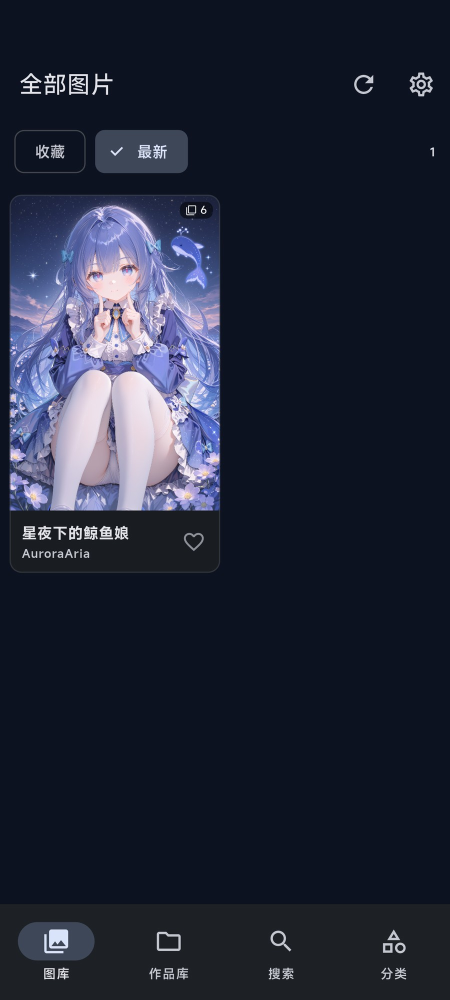
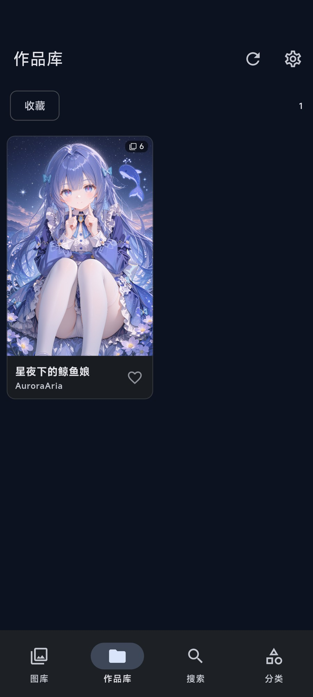
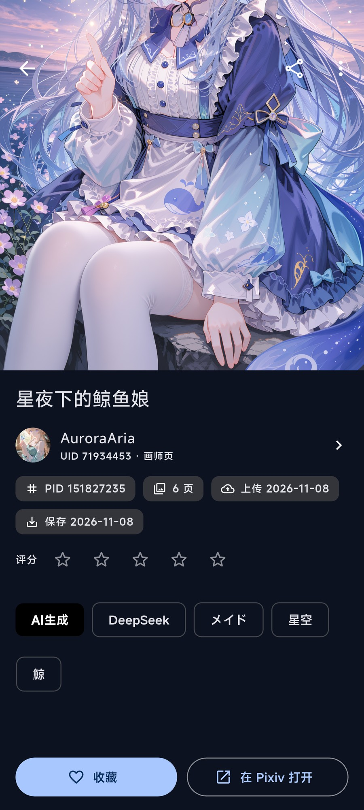
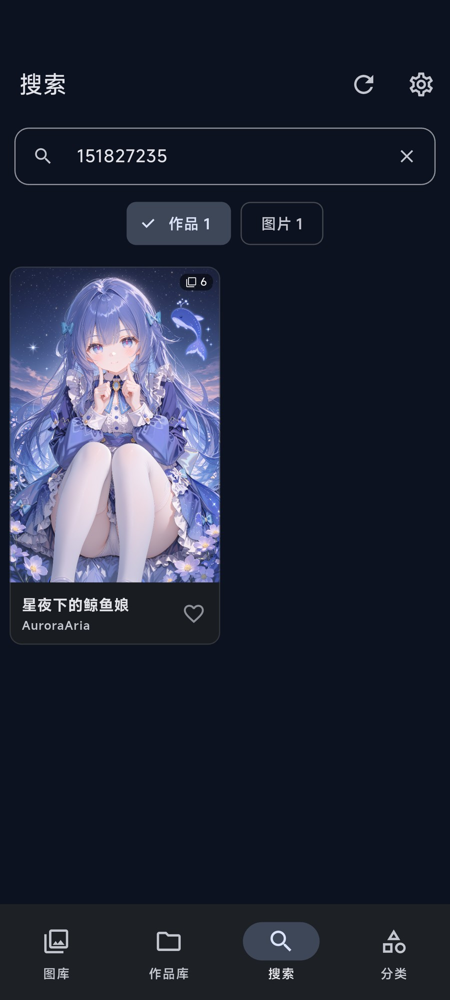
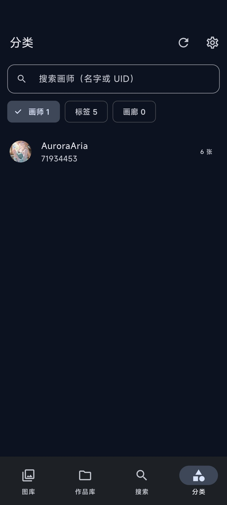
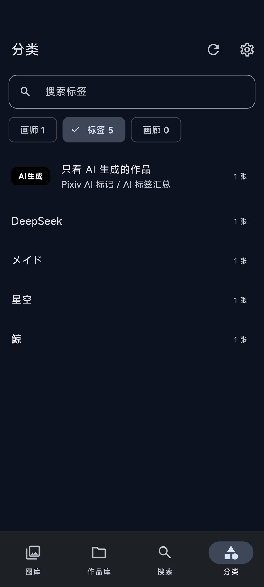
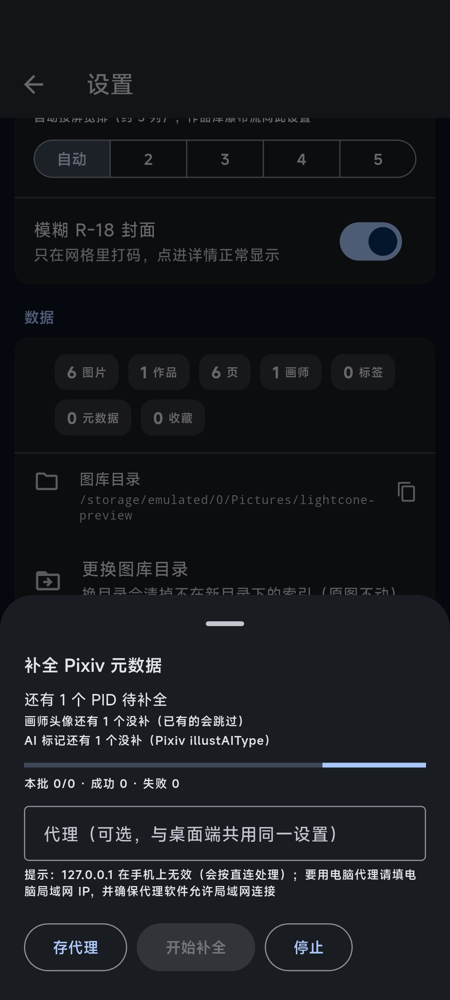

# 光锥图库 · LightCone Gallery（Android / Flutter）

> 本地优先的 Pixiv 作品仓库：索引 pixez 下载到的图，按作品归组、竖排长图看画，
> 收藏 / 评分 / 标签画廊全部离线可用。与桌面端
> [lightcone-gallery](https://github.com/AuroraEvelynAria/lightcone-gallery)
> 共用同一套 schema v12，元数据、收藏与评分可以在两端之间合并。

<p align="center">
  <a href="docs/screenshots/gallery.jpg"></a>
  <br /><sub>图库：一个作品一张卡，右下角标页数；预览库只有这一件作品</sub>
</p>

<p align="center">
  <a href="docs/screenshots/artworks.jpg"></a>
  <br /><sub>作品库：同一 PID 的 6 页只占一张卡，标题 / 画师 / 收藏在卡外</sub>
</p>

<p align="center">
  <a href="docs/screenshots/detail.jpg"></a>
  <br /><sub>详情：整组图竖向排开，评分与标签在图片下方（AI生成标签在首位）</sub>
</p>

<p align="center">
  <a href="docs/screenshots/search-pid.jpg"></a>
  <br /><sub>搜索 · PID：输入 151827235 直接命中这件作品</sub>
</p>

<p align="center">
  <a href="docs/screenshots/search-artist.jpg"></a>
  <br /><sub>搜索 · 画师：输入 AuroraAria，只出现这一件本地作品</sub>
</p>

<p align="center">
  <a href="docs/screenshots/browse-artists.jpg"></a>
  <br /><sub>分类 · 画师：预览库里只有 AuroraAria 一位画师</sub>
</p>

<p align="center">
  <a href="docs/screenshots/browse-tags.jpg"></a>
  <br /><sub>分类 · 标签：只有这件作品的 5 个标签（含 AI 生成汇总）</sub>
</p>

<p align="center">
  <a href="docs/screenshots/settings.jpg"></a>
  <br /><sub>设置 · 补全元数据：正在补全这件作品的 Pixiv 元数据（1 个 PID）</sub>
</p>

> 预览图只使用作者本人的《星夜下的鲸鱼娘》（Pixiv
> [151827235](https://www.pixiv.net/artworks/151827235)，画师 AuroraAria），预览库
> 只放了这一件作品；截图里的标题 / 画师 / UID / 标签都是这件作品的真实元数据，
> 没有其他画师的信息。插画为 AI 生成，无 NSFW。

## 功能

- **一个作品一张卡**：同一 PID 的几十页只占一格，右下角标页数
- **竖排长图**：详情页把所有页按原比例竖向拼接，点任意一页进单张检视器（左右滑）；
  横图不会被压成顶栏下的一条 —— 给更高的舞台与模糊环境底，第一页还会让开顶栏
- **沉浸式详情**：图片顶到状态栏，顶栏只有浮动的返回 / 分享 / 菜单（pixez 同款，
  不压标题与整条黑罩），标题与画师在图片下方；底部常驻收藏 / 在 Pixiv 打开
- **收藏 · 评分 · 标签画廊 · 多选批量操作**
- **AI生成标签**：详情页标签首位（黑底白字），点一下筛选全部 AI 生成作品；
  分类页标签列表也置顶（合成标签，不污染原始标签）
- **画师页**：点头像 / 画师名进入 —— 头部是本地汇总（作品 / 页 / 收藏 / 占用 /
  上传跨度 / 常用标签），下面是这个画师的作品瀑布流；有网上作品清单时再显示
  「本机 N / 线上 M」和「只看缺的」，缺的排占位卡跳 Pixiv（图源仍只认本机索引）
- **画师头像**：补全元数据后接着按画师补头像（已有就跳过，全增量），打开详情
  时也会按需补；没网 / 没代理时显首字母
- **分享 · 设为壁纸**：详情页可把整组图一次分享（多页走 `ACTION_SEND_MULTIPLE`），
  检视器分享当前一张；分享走 `FileProvider`，不暴露真实路径。聊天软件默认会压缩
  图片，所以另给了「以文件分享（不压缩）」和「保存原图到相册（Pictures/LightCone）」。
  菜单里可设为主屏 / 锁屏 / 同时。
- **目录可选**：首次启动选图库目录（默认 `Pictures/pixez`），设置里随时更换；
  目录选择走**应用内目录树**（MediaStore 整理，不经过系统 SAF），不会被
  「李跳跳 / GKD」这类无障碍自动点击器瞬间点掉
- **与桌面互通**：导入桌面备份（元数据 / 收藏 / 评分 / 画廊），也能导出 `.db` 回桌面
- **观感**：六套配色、深浅主题、R-18 封面模糊、自适应布局（横屏左侧导航）
- **元数据补全**：免 OAuth 的 Pixiv ajax 端点，限流语义与桌面版一致
- **启动自动补全**：打开软件后增量扫描当前目录，发现新作品自动补元数据
  （每次最多 50 条，联网预检，不挡开屏；设置里可关）

## 为什么换 Flutter，以及它为什么流畅

> 这是手机端的第三个实现：Tauri/WebView → Kotlin/Compose → **Flutter**。
> 换栈的原因不是框架崇拜，而是**流畅度**：参照片源客户端 pixez 的做法，
> 把「网格里显示什么」和「构建产物」这两件事做对。

| | pixez | Kotlin 版（之前） | 本版 |
|---|---|---|---|
| 网格里的图 | CDN 的 360~540px 缩略图 | **本地 2000~3000px 原图现解** | **系统缩略图**（MediaProvider 预生成） |
| 构建 | release | debug（无优化） | release |
| 每格解码成本 | 极小（图本身就小） | 大（8~12MP JPEG） | 极小（`loadThumbnail`，命中系统缓存） |

所以本版的关键设计只有一条：**网格里永远不解码原图**，缩略图走
`ContentResolver.loadThumbnail`（Android 29+，更低版本走旧 Thumbnails API）。
原图只在检视器里解一次。

## 结构

```
lib/
  main.dart                    启动壳：第一帧出开屏，开库/迁移在背后跑
  state/
    app_state.dart             权限 / 扫描 / 导入 / 数据版本（刷新信号）
    app_settings.dart          本机偏好：主题、网格列数（settings 表，mobile_ 前缀）
  data/
    schema.dart                与桌面 schema v12 **逐字对齐**的建表语句
    db.dart                    sqflite 打开 / 校验 / 导入桌面备份（版本+quick_check）
    models.dart                模型 + parsePid / parseArtist（与 Rust 测试镜像）
    repository.dart            所有 SQL：分页 / 检索 / 分类 / 扫描增量 / 元数据落库
  media/
    media_channel.dart         原生通道（枚举 / 缩略图 / 权限 / 选备份）
    thumbnail_provider.dart    系统缩略图 ImageProvider
  pixiv/pixiv_client.dart      免 OAuth ajax 端点 + 代理 + 桌面同款限流语义
  pixiv/artist_avatar.dart     画师头像：/ajax/user/{uid} 拉取、本地缓存、失败冷却
  ui/
    splash_screen.dart         开屏（光锥标记 + 淡入）
    settings_screen.dart       设置：外观 / 数据 / 网络 / 关于
    artwork_detail_screen.dart 作品详情（pixez 层级：大图翻页 / 标题 / 画师 / 标签 / 收藏）
    page_stage.dart            长图一页的版面（横页舞台 / 模糊底 / 顶栏让位，可单测）
    artist_screen.dart         画师页：本地汇总头部 + 画师作品瀑布流
    artist_avatar_view.dart    画师头像（缓存优先，详情页可后台按需拉）
    artwork_card.dart          作品卡：预览 + 标题 + 画师 + 收藏心（pixez 同款）
    filtered_artworks_screen.dart 画师 / 标签筛选后的瀑布流
    brand.dart                 光锥标记的 CustomPainter（开屏与关于共用）
    ...                        四 tab + 检视器 + 补全面板
android/app/src/main/kotlin/.../MediaStoreChannel.kt
                               枚举 / loadThumbnail / 权限 / SAF 选备份
android/app/src/main/res/drawable/ic_lightcone*.xml
                               系统开屏图标与自适应图标（矢量，同一标记）
```

## 与桌面端的数据互通

- 打开的是**同一套 schema v12**（16 张表）；`sqflite` 就是 Android 原生
  SQLite，不做 Room 那种逐列校验，所以导入桌面备份**直接换文件**即可：
  校验 `user_version == 12`、`quick_check == ok`、必需表齐全 → 关库 →
  拷贝 → 删 `-wal/-shm` → 重开。
- 本端额外多两张私有表（每次打开 `IF NOT EXISTS` 补建）：
  - `media_ids(path, media_id)`：缩略图要拿 MediaStore 行号去要，路径是唯一的
    稳定桥梁。桌面导入的行没有行号，UI 自动退回文件解码。
  - `illust_ai(pid, ai_type)`：存 Pixiv 的 `illustAIType`（2 = AI 生成），
    桌面 schema 没有这一列；没有行的老数据用 AI 标签兜底。两张表都不在桌面
    导出的必需表清单里，多出来也不影响桌面导入。

## 扫描语义（与桌面 / Kotlin 版一致）

- 作品库：MediaStore 一次枚举 → **只认 `Pictures/pixez` 根下的文件**（与图库同口径，
  别处下载的 pixiv 命名文件不再混进来）→ `{pid}_p{n}` 解析 → `(pid,page)` 去重 +
  忽略名单 + 画师路径反推 + 根目录落盘。已知 `(pid,page)` 换了路径（桌面导入后
  重扫）会就地更新为手机路径，不会因为唯一索引而卡住旧路径。
- 图库：**扫当前根目录**（默认 `/storage/emulated/0/Pictures/pixez`，首次启动引导里
  可以选别的目录，之后在设置里也能换），按 `(path,size,mtime)` 增量 + 差集删除。
  旧版把整个 `Pictures` 当根的库会在启动时自动迁移并清掉不在根下的行。
  换根会就地迁移旧库（收藏/评分保留在新根下的文件上），不在新根下的索引立刻清掉。
- 分类：画师 / 标签**不设上限**（早期写死 500，真机验证时发现并去掉），
  顶部搜索框在内存里按名字过滤，标签几千个也能秒找（标签列表按作品数排序）。
- 元数据补全：串行 800ms、连续 3 败中止、429/403 立停、每 200 条歇 30s、
  非 200 不重试（但 TLS / 连接异常先等 300ms 重试一次 —— 代理节点偶发
  掐握手时这是最常见的一类错）、限流词跨语种判定。代理与桌面共用 settings 表的
  `pixiv_proxy` 键（导入备份自动带来）；**127.0.0.1/localhost 在手机上会被
  视为「直连」**（桌面的回环地址在手机上指向手机自己）。
- **启动自动补全**（`AppState.autoSyncOnLaunch`，设置键 `mobile_auto_meta`，
  默认开）：首帧后 `ensurePermission` → `scanAll` 增量 → 有缺元数据的新作品
  → `PixivClient.probePixiv` 4s 预检（连不上就跳过，不白等 3×20s 超时）→
  `fetchMeta(maxCount: 50)`；与手动补全共用 `metaBusy` 锁；完成后 SnackBar
  报「已补全 X 部」。AI 标记随新元数据落库；头像仍按需/手动批补，
  旧作品的 AI 回填仍是手动长任务。
- **从另一份 LightCone 索引合并元数据**（⋮ →「从桌面备份补元数据」）：
  `ATTACH` 源库后只 `INSERT OR REPLACE` `illust_meta`（成功/确认删除的行）、
  `illust_tags` 与 `artists.name`，**不动本机 artworks / images**。
  桌面已有 4,183 条元数据 + 31,075 个标签时，这一步几乎瞬间完成，
  剩下的新作品再联网补 —— 不必对着 6,700 条串行抓 90 分钟。
  原因：桌面库的 `original_path` 是 Windows 路径，整库替换会让手机上的图全打不开；
  而元数据按 PID 挂，与路径无关。

## 以 pixez 为标准的界面

- **自适应布局**：宽度 ≥ 600dp（横屏 / 平板）时底部导航换成左侧 `NavigationRail`，
  四个 tab 不变；竖屏仍是底部 `NavigationBar`。
- **多选批量操作**（作品库）：长按任意卡片进入多选，点卡片勾选/取消；底部动作
  条是「已选 N · 收藏 · 移出」。收藏按 PID 整组写，移出只动索引。
- **标签画廊**（分类页第三个 chip）：只读桌面端的 `tag_galleries`（名字 + 标签
  组合），点进去用这些标签筛作品；元数据合并时会一并带过来。
- **导出备份**：设置 →「导出备份」把当前索引写成一个 `.db`（WAL checkpoint 后
  拷副本），经 SAF 让用户选保存位置；桌面端「导入备份」可直接用。不用
  `VACUUM INTO` —— Android 8 的 SQLite 没这条语法。
- **作品卡（pixez 同款）**：预览图按原比例进瀑布流，下面是**标题 + 画师**，
  图片右上角是页数角标、右下角是**收藏心**（在图片外面，点心只切收藏）。
  图库 / 作品库 / 搜索 / 筛选 / 画师页统一用 `ArtworkCard`；图库也从方格改成
  了瀑布流，缩略图不再被方形裁切硬放大。
  缩略图请求按「格宽 × 1.6」要（2 列约 976px、5 列约 390px，上限 1024）——
  系统缩略图是方形，竖卡要裁 3:4，只按格宽要会被放大一轮。
- **沉浸式顶栏**（对齐 pixez）：`extendBodyBehindAppBar` + 透明 AppBar + 顶部渐变
  压暗，图片从状态栏底下开始，返回 / 菜单 / 标题（17sp）+ 画师（11sp）浮在图上；
  信息块在图片下方，操作放底部常驻栏。
- **详情页 = 竖排长图**（pixez 的「看的时候拼成长图」）：**图片顶在最上面**，
  标题 / 画师固定收在 AppBar 副标题；完整信息（标题 / 画师 / 评分 / PID / 页数 /
  日期 / 标签）在长图之后。所有页按原始比例竖向拼接，页与页之间 2px 缝；
  **点任意一页**进单张检视器，左右滑切页。用 `SliverList` 按需构建，51 页也
  不会一次性解码；解码按屏宽 `cacheWidth`，不会整张原图进内存。
- **横页单独排版**（`ui/page_stage.dart`）：宽高比 > 1.2 的页给一个至少
  `0.56 × 屏宽` 高的舞台，空出来的地方铺同一张图的模糊放大（1/8 尺寸解码再
  高斯模糊，成本可忽略）；**作品第一页是横图时，舞台顶部让出状态栏 + 顶栏的
  高度**，真图从顶栏下方开始 —— 旧版 3.5:1 的全景图只剩顶栏底下一条，既难看
  又点不到。左下角「看全图」只是提示，整块舞台都可点进检视器。
- **检视器双击缩放**：横图默认整张显示（铺满宽度），双击在「整张」和
  「铺满屏高」之间切换（3.5:1 约 7.7 倍），放大后左右拖动看细节；横图底部有
  「双击切换大小 · 拖动查看」提示。竖图双击给 2 倍，比例未知也按 2 倍。
- **画师页**（`ui/artist_screen.dart`）：详情页的画师行（头像 + 名字）和分类页
  的画师条目都进这里。头部 `artistProfile()` 一条 SQL 取作品/页/收藏/占用 +
  `illust_meta` 的最早/最晚上传日期，再加 `illust_tags` 出现最多的 8 个标签
  （可点，跳标签筛选）；下面复用作品库的 `SliverMasonryGrid` 瀑布流。
  **图源仍然只有本机索引** —— Pixez 下载到 `Pictures/pixez` 的才算，画师页不
  联网补全；右上角「在 Pixiv 打开画师页」只是跳转。
  - **线上缺口视图**（`pixiv/artist_artworks.dart`）：顺手拉一次
    `/ajax/user/{uid}/profile/all`（`illusts` + `manga` 的 key 就是 PID），
    缓存在 `<appSupport>/artist_artworks/<uid>.json`（7 天 TTL，失败退回旧缓存，
    顶栏 ☁️ 可手动刷新）。与本机 `artworks` 分块比对（500 个一批，SQLite 变量
    上限 999）后显示「本机 N / 线上 M」与「只看缺的」：缺的排成占位卡，
    点一下去 Pixiv —— **下载还是 pixez 的事**，重扫一次就补上。
    拉不到清单时只显示本机部分，页面照常用（不阻塞、不报错）。
  - 分类页每行也带头像，但只显示批量补好的缓存（`fetch: false`）——
    一屏几十行逐行联网会把 Pixiv 打爆。
- **一个作品一张卡**：图库 / 作品库 / 搜索 / 筛选页都按 PID 归组（封面 = 最小页，
  多页作品右下角有「N」页角标）。之前的实现把 51 页拆成 51 张卡，真机上就是
  同一个角色刷满整屏。
- **详情页底部常驻**「收藏 / 在 Pixiv 打开」：51 页的长图滚到底要两万多像素，
  动作不能埋在信息末尾。
- **日期分两个**：`上传` 取 Pixiv 的 `illust_meta.create_date`（作品发布日），
  `保存` 取本地文件 `images.modified_at` 的最大值（下载到手机的时间）。两者分开
  显示，元数据还没补的作品就只显示保存时间。
- **画师头像**（`pixiv/artist_avatar.dart`）：详情页先找
  `<appSupport>/artist_avatars/<uid>.img`，没有或超过 30 天才联网；
  `/ajax/user/{uid}?full=1` 返回的 `imageBig` / `image` 必须是 `i.pximg.net` 的
  https 地址（响应是外部数据，不拿它当任意 URL 下载器），走同一个 `pixiv_proxy`；
  下载先走原地址重试 2 次，再试同一路径的 `i-cf.pximg.net`（某些代理节点对
  `i.pximg.net` 会直接断握手）。
  - **批量补**：「补全 Pixiv 元数据」跑完作品元数据后，接着按
    `artistUidsWithArtworks()`（作品数从多到少）补头像：
    `<uid>.img` 存在就跳过；**只有接口 200、body 正常且确实没有头像字段**
    才写 `<uid>.none`（v2 JSON），错误信封 / 限流 / 形状异常一律算失败、不写
    标记 —— 旧版把错误响应当成「没头像」，会把一批人误标成「补过了」。
    旧格式（纯时间戳）的 `.none` 打开时自动删掉重排。
    失败 / 停止都只是断点，再跑接着补，是纯增量。
    限流与元数据同一套：串行 800ms、每 200 个歇 30s；**连续 5 个画师失败才停**
    （3 太容易误停：偶发握手失败 / 个别被墙的画师会凑出 3 连败），
    HTTP 404（删号）直接记为无头像，不算失败。汇总会带上最近一次失败原因，
    不再只报「失败 N」。
    批量完成会 `bumpData()`，分类页按 dataVersion 重建头像组件 ——
    补完即时显示，不用重启或切 tab（以前头像只在 initState 读一次缓存）。
  - **按需补**：打开作品详情时没有文件才联网，超过 30 天刷新；失败冷却 2 分钟，
    避免没代理时每个详情页都干等 20 秒连接超时。失败 / 离线时保留首字母占位。
- **收藏 / 评分**：作品库顶部有「收藏」筛选；详情页顶栏只有浮动图标，
  标题 / 画师 / 评分在图片下方的信息区，评分是 5 星、再点同一颗清零。两者都按
  PID 整组生效（`images` 里同一 PID 的所有页一起改）。
- **从桌面备份补元数据**时，除了标题/画师/标签，还会按 PID 合并**收藏与评分**
  （桌面的路径是 Windows 的，不能按 path 对；手机端取组内最大值）。
- **AI生成标签**：详情页标签区的第一枚是黑底白字的「AI生成」（圆角矩形），
  点它进 AI 筛选；分类 → 标签列表的第一条也是它（本机 195 张）。
  判定 = Pixiv `illustAIType == 2`（新补的元数据写进私有表 `illust_ai`）
  ∪ 常见 AI 标签的全名匹配（`AI生成` / `AIイラスト` / `ai` / `AI-generated`
  / `ai-assisted` / `NovelAI` …，不会把 Honkai 这类含 "ai" 的词算进来）。
  老元数据没有 Pixiv 标记时先靠标签兜底；**「补全 Pixiv 元数据」面板的
  第三阶段会逐条回填 `illustAIType`**（本机 4,289 个老作品，800ms 限流，
  可停可续），回填后详情 / AI 筛选 / 计数都以 Pixiv 标记为准，不再依赖标签。
  原始 AI 标签从普通标签列表里收掉，避免同一个意思出现好几枚。
- **R-18 封面模糊**（设置 → 外观，默认开，键 `mobile_blur_r18`）：网格里
  `x_restrict > 0` 的封面用 GPU 高斯模糊 + `R-18` 角标，**点进详情正常显示**。
  判定用 Pixiv 的 `x_restrict` 而不是看标签 —— 本库 4,183 个作品里只有 655 个
  是 Pixiv 标记的 R-18（另外 13 个带 R-18 标签但 x_restrict=0），所以看着露骨的
  图不一定被糊，这是按 Pixiv 的尺度走的结果。
- 详情页右上角菜单里有「移出作品库」（两段确认、不动原图）；作品库瀑布流里
  长按也能移除单页。
- 曾经用 `precacheImage` 预热 PageView 的左右邻页；改成竖排长图后这套就不需要了
  （`ListView` 的 `cacheExtent` 会顺带构建下一屏），已移除。

## 设置与开屏

- **首次启动引导**（`ui/onboarding_screen.dart`）：数据库里还没有任何图库时显示，
  让用户选目录（默认 `Pictures/pixez`，或 SAF 选任意内部存储目录）。SAF 的 tree
  URI 由原生侧 `DocumentsContract.getTreeDocumentId` 解析成绝对路径前缀；只支持
  主存储（`/storage/emulated/0/...`）。
- **开屏**：`main()` 只做 `runApp`，开库 / `ensurePhoneLibrary` / 读设置都在开屏
  背后跑，最短停留 600ms 以免一闪而过；权限对话框放到主界面出现之后，不盖在
  开屏上。Android 12+ 的系统启动窗口也是同一品牌色（`values-v31` +
  `values-night-v31`），从系统开屏到 Flutter 第一帧不会闪白。
- **图标**：`drawable/ic_lightcone.xml`（系统开屏）与
  `drawable/ic_lightcone_foreground.xml` + `mipmap-anydpi-v26`（自适应图标）都是
  同一个矢量光锥，不再用 Flutter 默认图标。
- **设置页**（首页右上角齿轮）：
  - 外观：主题（跟随系统 / 深色 / 浅色）、**配色**（深空蓝 / 樱粉 / 海盐青 /
    森绿 / 琥珀 / 紫罗兰，种子色 + 对应深色底）、网格列数（自动 / 2 / 3 / 4 / 5）、
    **模糊 R-18 封面**（默认开）；
  - 数据：图片/作品/页/画师/标签/元数据/收藏计数、**图库目录与更换目录**、扫描、
    **启动时自动补全新作品**（每次最多 50 条）、从桌面备份合并元数据、补全元数据
    （元数据 → 画师头像 → AI 标记回填，全增量）、导入备份、清空忽略名单；
  - 网络：Pixiv 代理（与桌面共用 `pixiv_proxy` 键）；
  - 关于：版本、schema v12、数据库路径（点右侧复制按钮，不再长按弹系统菜单）。
  偏好键为 `mobile_theme` / `mobile_theme_seed` / `mobile_grid_columns` /
  `mobile_blur_r18` / `mobile_auto_meta` / `mobile_library_root` —— 加 `mobile_` 前缀是为了
  不和桌面的键打架；导入桌面备份整表替换设置时这些键会丢，读不到就用默认值。

## 构建

```bash
export PATH="/f/Tools/flutter/bin:$PATH"
export PUB_HOSTED_URL=https://pub.flutter-io.cn
export FLUTTER_STORAGE_BASE_URL=https://storage.flutter-io.cn
export JAVA_HOME="/c/Program Files/Zulu/zulu-21"

cd F:/LightConeFlutter
flutter pub get
flutter build apk --release      # release 用 debug 签名，可直接覆盖安装
```

产物：`build/app/outputs/flutter-apk/app-release.apk`

包名 `com.lightcone.gallery.flutter`，与 Tauri 版（`com.lightcone.gallery`）、
Kotlin 版（`com.lightcone.gallery.android`）并存，互不覆盖数据。

## 真机验证（2026-11-06，K70 Ultra，release 包）

已完成：
1. ✅ 首次启动权限；
2. ✅ ⋮ →「扫描手机图片」：**作品库 6,702 / 图库 24,977**，MediaStore 一次枚举后秒级入库；
3. ✅ 图库方格网格、作品库瀑布流、搜索（PID 命中 1 条）、分类（画师 500 位带计数）、
   检视器（原图全屏 + 页码标题）；
4. ✅ 帧率（screenrecord + ffprobe 帧时间戳）：滚动期间 **p50 8.3ms（120Hz）、
   p90 9.1ms**，>20ms 的间隔只占 1.4%（且都是松手后的静止期）；
5. ✅ 设置页 / 开屏 / 图标 / 作品详情页（2026-11-06 晚，release 包，真机）：
   - 开屏「光锥 + 淡入」正常，没有缺 Material 的黄色双下划线；系统开屏与图标
     都是同一品牌色 + 矢量光锥；
   - 设置页：深色 / 浅色即时切换；网格列数 2/3/4/5 即时生效，2 列时缩略图
     按 540px 取，不糊；
   - 归组：搜 `151241832` 只出 **1 张卡 + 51 角标**；作品库同一页作品不再重复；
   - 长图详情：51 页竖向拼接可滚动，点某页进单张检视器并落在对应页（实测
     `2 / 51`）；
   - 分类搜索：输入 `R-18` → 画师匹配 0、标签匹配 1（652 张），点进筛选页正常。
6. ✅ 图片置顶 / 收藏筛选 / 评分 / 扫描口径（2026-11-07 凌晨，release 真机）：
   - 详情页**图片顶在最上面**，标题与画师在 AppBar 副标题常驻；完整信息在长图后；
   - 点第 3 颗星 → 评分写入成功（重进页面仍是 3 星，说明落了库）；
   - 作品库「收藏」筛选选中后只剩 1 件（测试收藏的那张），计数 1；
   - 作品页数 6,701 → 6,657、作品 4,183 → 4,181，说明启动时的「只收 pixez 根」
     清理生效；现在 6,668 图 / 6,657 页（11 张是 pixez 目录里非 `{pid}_p{n}`
     命名的文件）；
   - 「从桌面备份补元数据」的收藏/评分合并需要 SAF 选文件，尚未在真机点过。
7. ✅ 配色与换目录（2026-11-07，release 真机）：
   - 设置 → 外观 → 配色切到「樱粉」：背景/分段控件/开关全部跟着变粉，切回
     「深空蓝」恢复；色板持久化在 `mobile_theme_seed`；
   - 设置 → 更换图库目录：能拉起系统 SAF 目录选择器（取消后无副作用）；
   - 首次引导页只有在「一个图库都没有」时出现，本机已有库，未在真机走过完整流程。
8. ✅ 横屏导航 / 多选 / 导出 / 标签画廊（2026-11-07 凌晨，release 真机）：
   - 横屏后左侧出现 `NavigationRail`（图库/作品库/搜索/分类），内容在右；
   - 作品库长按进入多选，连点两张 → 「已选 2」，选中有压暗 + 勾；
   - 「导出备份」走完 SAF：生成 `lightcone-20261107.db`（16.8MB），拉回校验
     `user_version=12`、`quick_check=ok`、6,817 图 / 4,252 作品 / 1 收藏，与手机一致；
   - 分类页出现「画廊」chip；本机 `tag_galleries` 还是 0（桌面那 1 个画廊要再跑
     一次「从桌面备份补元数据」才会合并进来）。
9. ✅ 横图详情与检视器（2026-11-07 晚，release 真机）：
   - 搜 `147023216`（6605×1858，3.55:1）→ 详情页真图从顶栏下方开始，整块舞台
     可点；点图进检视器，双击铺满屏高（约 7.7×），再双击还原；
   - 本机 6,857 个 pixez 文件里有 **1,798 张横图**（宽 > 高），宽高比中位数
     1.69、p95 2.11、p99 3.0 —— 横页不是个例，必须在长图里单独排版；
   - 新增测试：`test/page_stage_test.dart`（舞台高度 / 顶栏让位 / 整块可点）、
     `test/viewer_zoom_test.dart`（铺满屏高的倍率）、
     `test/viewer_double_tap_test.dart`（双击放大与还原）。
10. ✅ 画师头像（2026-11-08 凌晨，release 真机）：
    - 搜 `147023216` 进详情：后台拉 `/ajax/user/95030208` 拿到 `imageBig`，
      头像显示在画师行（36dp 圆形），首字母占位自动换掉；
    - 本机走 Clash Meta 的 TUN（手机上 `pixiv_proxy` 是空的）。第一次
      `i.pximg.net` 被节点的 TLS 握手掐断（Clash 日志能看到命中的台湾节点），
      重试后拿到 62,765 字节 PNG —— 节点抽风就会这样，所以下载做成
      「原地址重试 2 次（间隔 250ms）→ `i-cf.pximg.net`（同路径 Cloudflare
      入口）兜底」。像素对比确认头像区从占位首字母（127 色 / std 29.5）
      换成了真实头像（5914 色 / std 89.2）；
    - 新增测试：`test/artist_avatar_test.dart`（字段优先级 / 只收 pximg 的
      https / 错误信封）。
    - 增量批量：设置 →「补全 Pixiv 元数据」跑完元数据后自动接头像阶段。
      本机 1,609 个有作品的画师里先补了 95 个、停两次再跑，进度从
      `4/1539`、`n/1525` 接着走（跳过的 83 个就是已补的），确认是断点续传。
11. ✅ 画师页（2026-11-08 凌晨，release 真机）：
    - 详情页画师行（头像 + 名字 + `UID … · 画师页` + `›`）整行可点，
      分类页画师条目也进同一页；
    - `火柴蝎Msc`（17 作品 / 23 页 / 1 收藏 / 620 MB / 2025-02-10 ~ 2026-10-02）、
      `逆流茶会`（583 作品 / 991 页 / 10.6 GB / 2020-03-20 ~ 2026-10-03）头部
      数字与桌面库手查一致（`python sqlite3` 直接对过同一批 SQL）；
    - 头像取自批量补的缓存，分类页首屏能看到真实头像（没补的显首字母）；
    - 新增测试：`test/artist_profile_test.dart`（`formatBytes` 进位 /
      名字回退 / 日期截断）。
12. ✅ pixez 式作品卡与高清预览（2026-11-08，release 真机）：
    - 图库 / 作品库 / 搜索 / 筛选 / 画师页统一成「预览图 + 标题 + 画师 +
      图外收藏心」；图库从方格改成按原比例的瀑布流；
    - 2 列时缩略图改成按格宽从文件降采样（系统方形缩略图裁 3:4 会被放大），
      3 列以上仍走系统缩略图；真机目视明显更清楚；
    - 真机点卡片上的心：变成「取消收藏」、不打开详情，再点还原；页数角标在
      图片右上角（pixez 同款）；
    - 新增测试 `test/artwork_card_test.dart`（标题/画师/页角标、点心不触发整卡）。
13. ✅ 画师页线上缺口（2026-11-08，release 真机）：
    - 画师页顺手拉 `/ajax/user/{uid}/profile/all`，缓存在
      `<appSupport>/artist_artworks/<uid>.json`；比对本机 PID 后显示
      「本机 N / 线上 M」+「只看缺的 M」筛选，缺的排占位卡点跳 Pixiv；
    - 真机验证时主人手机的 Clash 已经退出（`tun0` 消失、`pixiv.net` 解析到
      真实 IP 但 100% 丢包），两次连接都 20s 超时 —— 页面如期退回本机部分并
      显示「拉不到线上清单（检查代理 / 网络）」，没有卡住或崩；
    - 新增测试：`test/artist_artworks_test.dart`（插画+漫画合并、PID 去重降序、
      错误信封 / 非数字 key）。
14. ✅ 补全常错的修复（2026-11-08，release 真机）：
    - 手机 Clash 节点偶发掐 TLS 握手时，元数据单条请求先等 300ms 重试一次；
      本次跑 2 个待补 PID：**成功 2 · 失败 0**；
    - 头像批次从「连续 3 败停」改成「连续 5 败停」；HTTP 404（删号）记为
      `无头像`，不算失败。本次补 55、跳过已有 401、无头像 4、失败 0（手动停止），
      待补数 1222 → 1163，断点续传正常；
    - 汇总会带最近一次失败原因（如 `HandshakeException...`），不再只报失败数。
15. ✅ AI生成标签（2026-11-08，release 真机）：
    - 分类 → 标签列表第一条是合成的「AI生成」（黑底白字圆角矩形），显示
      195 张；原始 AI 标签（`AI生成` / `AIイラスト` / `ai` …）从普通列表收掉；
    - 点它进 AI 筛选页，作品卡正常；详情页标签区第一枚也是黑色「AI生成」，
      点它同样进 AI 筛选（实测「下头春 / 伽利略的闹钟」）；
    - 判定 = Pixiv `illustAIType == 2`（新元数据写私有 `illust_ai`）∪
      AI 标签全名匹配（Honkai 不误判）；
    - 新增测试 `test/ai_tag_test.dart`（标签匹配 / 详情判定）。
16. ✅ 画师头像同步修复（2026-11-08，release 真机）：
    - 旧版把用户接口的 `error` / 限流响应当成「没有头像」写 `.none`，
      导致整批被误标「补过了」；现在只有 200 + 正常 body + 确实无头像字段
      才写 v2 `.none`，错误算失败；旧格式 `.none` 打开时自动删掉重排；
    - 分类列表的头像只在 `initState` 读一次缓存，批量补完不刷新；现在补完
      `bumpData()`，头像组件按 dataVersion 换 key 重读，不用重启/切 tab；
    - 真机补完：1,610 个画师全部处理（跳过已有 1,610、无头像 13）；分类
      列表从顶到底绝大多数都有头像，13 个是 Pixiv 默认/无头像账号，显示首字母；
    - `flutter analyze` 干净，36 项测试全过。
17. ✅ AI 标记回填（2026-11-08，release 真机）：
    - 老元数据没有 Pixiv 的 `illustAIType`，很多 AI 作品只有标签、甚至没标签；
      「补全 Pixiv 元数据」面板新增第三阶段，逐条打 `/ajax/illust/{pid}`
      取 `aiType` 写进私有 `illust_ai`，**只写标记，不动标题/标签**；
    - 本机待补 4,289 个；试跑 192 个：成功 192、无作品 0、失败 0，
      待补降到 4,097，停止后可继续；回填后详情/AI 筛选/计数按 Pixiv 标记；
    - 800ms 限流、连续 3 败停、可停可续；AI 标签的全名匹配继续兜底没回填到的作品。
18. ✅ 启动自动补全（2026-11-08，release 构建；真机锁屏待目视）：
    - 首帧后静默 `scanAll` 增量扫描；有缺元数据的新作品时先用 4s 探一次 Pixiv
      （连不上就跳过），最多补 50 条；与手动补全共用 `metaBusy` 锁；设置 →
      数据里的「启动时自动补全新作品」可关；完成后 SnackBar 报「已补全 X 部」；
    - `flutter analyze` 干净，36 项测试全过，构建/装机通过；写这段时手机锁屏，
      完整的「加新图 → 开软件 → 自动补上」还没在真机目视，主人开屏即可验证。

`dumpsys gfxinfo` 对 Flutter 无效（引擎自绘，报 0 帧），要用 SurfaceFlinger/
录屏方式量。

### adb 自动化注意（本机实测）

- `input tap` 的零时长事件在 Flutter 里**经常不生效**；用
  `input motionevent DOWN/UP` 中间 sleep 0.12s 才稳。**这套手势在 K70 Ultra 上
  依然只有约 1/3 命中**，脚本里要连点/重试；定位控件别靠目测截图坐标（截图被
  缩放后目测误差几十像素），用 Pillow 扫像素找控件边界（边框/选中填充色）最稳。
- NavigationBar 的下沿落在系统手势区，点图标中心（约屏幕高 90% 处）才稳。
- MIUI 对新包名安装有 9 秒倒计时确认框，脚本点不赢 —— 手动装或先把「USB 安装」打开。
- Gradle 发行包需走腾讯镜像（`distributionUrl` 已改），否则证书校验失败。

## 许可

MIT，见 [LICENSE](LICENSE)。


